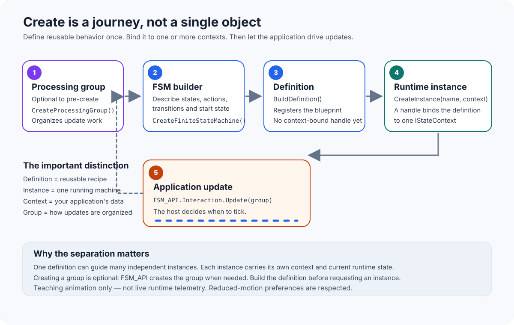

# FSM_API: Foundational Behavior Logic

FSM_API provides host-neutral state-machine behavior for C# applications. It separates reusable behavior definitions from the application-owned context objects those definitions operate on.

## Create: from design to execution

  

Start with the [Create workflow](Create.md) to understand how the API moves from an FSM definition to runtime instances. The diagram is a teaching animation, not live runtime telemetry.

## Core areas

- **[Create](Create.md)** — create processing groups, describe and register definitions, and instantiate them.
- **[FSM](FSM_API/FSM/FSM.md)** — the state-machine definition and its behavior.
- **Interaction** — interact with instances and drive processing from the host application's update loop.
- **Error** and **Internal** — diagnostics and internal management concerns.

## Architectural idea

- **Definition:** reusable behavior—states, transition conditions, and actions.
- **Instance:** one execution of that definition, represented by an `FSMHandle`.
- **Context:** application-owned data implementing `IStateContext`.
- **Processing group:** a named organization for update processing.

Keeping these concepts distinct supports reuse and testability without tying the core library to a particular UI, game engine, or domain model.
