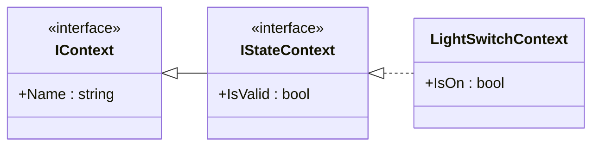
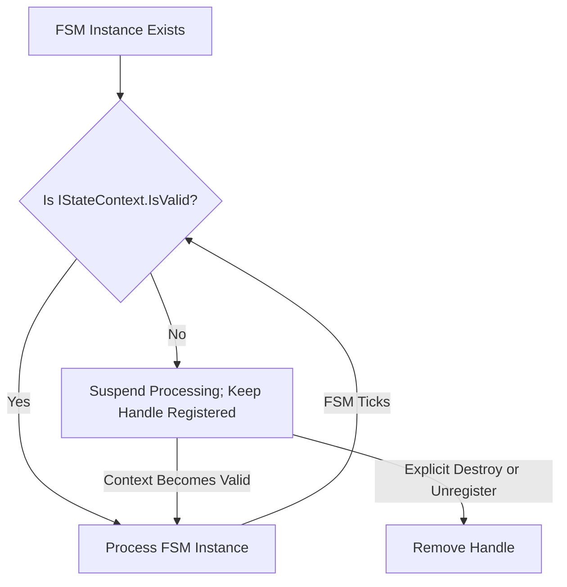

### `IStateContext` Interface: The State-Driven Data Model

The `IStateContext` interface represents the caller-owned data model whose behavior is processed by a finite state machine. It inherits the foundational `Name` contract from `IContext` and adds `IsValid`, which gates computation but does not control handle registration or destruction.

-----

### Purpose and Philosophy

`IStateContext` enforces a clear separation between your FSM's logic and your application's data. It ensures that any object you want to put under FSM control has a common set of characteristics: a unique name for identification and a flag (`IsValid`) to signal its active status. This design is paramount for preventing the FSM system from processing instances tied to objects that have been destroyed or are no longer relevant, such as a player who has left a game or a document that has been closed.

### UML Class Diagram

This UML class diagram illustrates the inheritance relationship between `IStateContext` and its parent interface, `IContext`. It also shows how a concrete class, such as a `LightSwitch`, would implement `IStateContext` to integrate with the FSM system.



  * `IContext` provides the `Name` property.
  * `IStateContext` inherits from `IContext` (`<|--`), adding its own `IsValid` property.
  * `LightSwitchContext` implements `IStateContext` (`<|..`), meaning it must provide both a `Name` and an `IsValid` property. It can also contain other data relevant to the light switch, like `IsOn`.

-----

### The `IsValid` Property: Lifecycle Management

The `IsValid` property is a computation gate, not an automatic destruction request. Scheduled ticks and manual stepping/condition evaluation skip computation when it is false; the handle remains registered and can resume when the same context becomes valid again. The caller owns the context object and its lifetime. Explicitly destroy a specific FSM handle when that instance should be removed; destroying one handle must not invalidate a context shared with other handles. This distinction is grounded in `FSM_API.Internal.TickAll`, `FSMHandle.Update`, `FSMHandle.EvaluateConditions`, and `FSM_API.Internal.DestroyInstance` on the development branch.

#### Lifecycle Flow: A Flowchart

The flowchart below demonstrates how the `IsValid` property governs the lifecycle of an FSM instance.



This diagram distinguishes suspension from removal: an invalid context is skipped during ticking, but its handle stays registered and can resume if the context becomes valid again. Explicit destruction or unregistration removes the handle.

-----

### Usage Example

The following code demonstrates a simple C\# class that could represent the data for a Light Switch and how it would implement `IStateContext`.

```csharp
/// <summary>
/// A concrete implementation of IStateContext for a simple light switch.
/// </summary>
public class LightSwitchContext : IStateContext
{
    public string Name { get; set; }
    public bool IsValid { get; set; } = true; // Assumes it starts as valid

    /// <summary>
    /// The state of the light switch (on or off).
    /// </summary>
    public bool IsOn { get; set; }

    public LightSwitchContext(string name)
    {
        Name = name;
    }
}

// In your application code
LightSwitchContext switchContext = new LightSwitchContext("KitchenLightSwitch");

// An FSM would be created and bound to this context.
// The FSM system will continuously check `switchContext.IsValid`.

// If the context is temporarily unavailable, setting IsValid to false
// suspends FSM processing but does not remove the registered handle:
// switchContext.IsValid = false;

// The handle remains registered while processing is suspended. If the context
// becomes valid again, processing can resume. If the light switch is permanently
// removed, explicitly unregister or destroy its FSM instance.
```