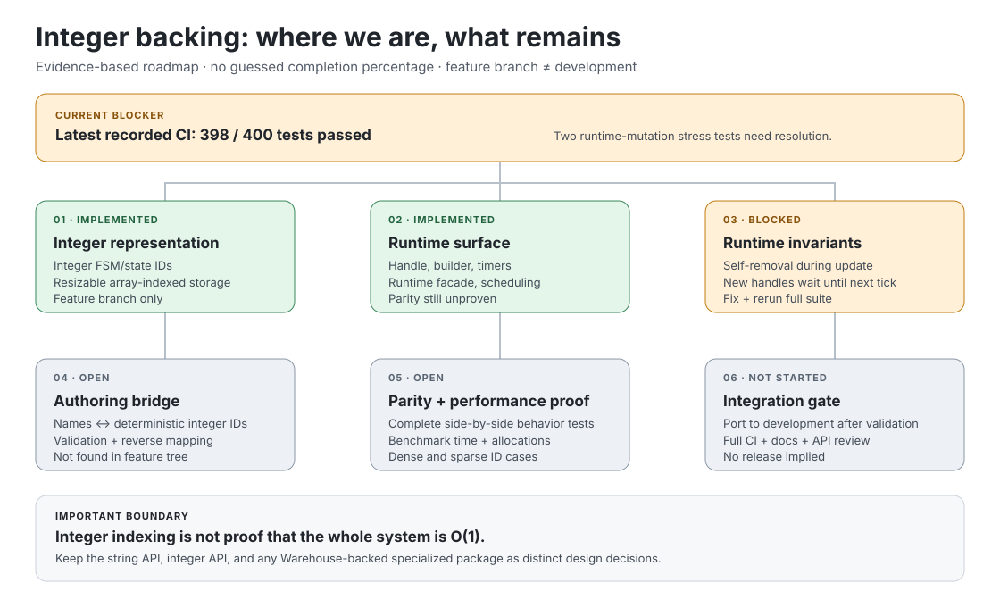

# Integer-backed FSM implementation — progress map

**Release checklist:** [FSM_API 2.0.0 Readiness — comprehensive remaining work](../../FSM_API_2.0.0_READINESS.md). This is the authoritative release-gate checklist, including Operation Sith branch cleanup, parity, benchmark, CI, documentation, and publication gates.

**Purpose:** make the remaining work visible so the integer-backed design can be resumed without reconstructing the whole vision from scattered commits.

> **Status in one sentence (2026-10-18):** the integer-backed runtime and its feature-branch tests have been ported into `development`, and a deterministic `FSMCompiler` bridge with reverse name mappings and focused tests has been added. The integration has not yet earned a new recorded green CI run; the historical 400/400 result applies only to feature-branch commit `dd96646`. Full parity, benchmark evidence, storage validation, branch cleanup, and release remain open.

  

## Current snapshot

- **Source of the original implementation:** [`feature/fsm-api-2.0`](https://github.com/TrentBest/FSM_API/tree/feature/fsm-api-2.0)
- **Current integration target:** [`development`](https://github.com/TrentBest/FSM_API/tree/development)
- **Integration snapshot:** the integer runtime and associated integer tests are now present under [`FSM_API/IntegerBacked`](https://github.com/TrentBest/FSM_API/tree/development/FSM_API/IntegerBacked) and [`Tests/IntegerBacked`](https://github.com/TrentBest/FSM_API/tree/development/Tests/IntegerBacked). The new string-to-integer compiler is in `FSM_API/IntegerBacked/FSMCompiler.cs`; current-branch CI validation is pending.
- **Latest feature-branch validation:** [run 39102742225](https://github.com/TrentBest/FSM_API/actions/runs/39102742225), commit [`dd96646`](https://github.com/TrentBest/FSM_API/commit/dd96646a3718923bb87a48af695a0c5b6819db8e), 2026-10-18. **400 passed, 0 failed**. The NuGet publish job was skipped; no package was published.
- **Historical regression:** [run 34809515652](https://github.com/TrentBest/FSM_API/actions/runs/34809515652) on 2026-09-14 had 398 passed and 2 failed out of 400. Those two update-loop tests now pass after the feature-branch fix described below.
- **Documentation CI:** [run 39102540029](https://github.com/TrentBest/FSM_API/actions/runs/39102540029) passed the local-link validator, DocFX generation, and documentation artifact upload on `development`. NuGet publishing was skipped.
- **No percentage is reported.** The gates have different weights, and “files exist” is not equivalent to “behavior is equivalent, faster, and safe to integrate.”

## Work already present on the feature branch

| Area | Evidence | Status |
|---|---|---|
| Integer state IDs and state storage | [`FSM.cs`](https://github.com/TrentBest/FSM_API/blob/feature/fsm-api-2.0/FSM_API/IntegerBacked/FSM.cs), [`FSMState.cs`](https://github.com/TrentBest/FSM_API/blob/feature/fsm-api-2.0/FSM_API/IntegerBacked/FSMState.cs) | Implemented |
| Integer FSM IDs and definition storage | [`FSMRuntime.cs`](https://github.com/TrentBest/FSM_API/blob/feature/fsm-api-2.0/FSM_API/IntegerBacked/FSMRuntime.cs) | Implemented |
| Runtime-facing API | [`FsmApi.cs`](https://github.com/TrentBest/FSM_API/blob/feature/fsm-api-2.0/FSM_API/IntegerBacked/FsmApi.cs), [`FSMHandleInt.cs`](https://github.com/TrentBest/FSM_API/blob/feature/fsm-api-2.0/FSM_API/IntegerBacked/FSMHandleInt.cs) | Implemented |
| Fluent builder, timers, transitions | [`FSMBuilderInt.cs`](https://github.com/TrentBest/FSM_API/blob/feature/fsm-api-2.0/FSM_API/IntegerBacked/FSMBuilderInt.cs), [`FSMTimersInt.cs`](https://github.com/TrentBest/FSM_API/blob/feature/fsm-api-2.0/FSM_API/IntegerBacked/FSMTimersInt.cs), [`FSMTransition.cs`](https://github.com/TrentBest/FSM_API/blob/feature/fsm-api-2.0/FSM_API/IntegerBacked/FSMTransition.cs) | Implemented; parity still to prove |
| Contract, lifecycle, edge, stress, and selected parity tests | [integer test suite](https://github.com/TrentBest/FSM_API/tree/feature/fsm-api-2.0/Tests/IntegerBacked) | Broad coverage exists; full feature-branch suite passes; complete parity remains open |

## Remaining gates — in dependency order

### 1. Runtime mutation invariants — **resolved on the feature branch; regression tests pass**

The fix is isolated on `feature/fsm-api-2.0`: [`FSMHandleInt.IsRegistered`](https://github.com/TrentBest/FSM_API/commit/4aa64deb10420b924b578fdc8134aa53bbd2d42a) tracks runtime membership, and [`FSMRuntime` tick snapshots](https://github.com/TrentBest/FSM_API/commit/0ff4b93d65f889c9fcbb32b4d5b19d3997573f85) prevent list mutation from skipping live handles or running newly created handles in the same tick. Removing the currently executing handle no longer shifts the next handle out of the iteration, and handles created by callbacks are not part of the current tick's snapshot.

The regression tests are `FSMRuntime_Stress_Tests.Update_SelfRemovalMustNotSkipTheNextHandle` and `FSMRuntime_Stress_Tests.Update_NewHandlesMustNotRunUntilTheNextTick`. Both pass in [the 400/400 feature-branch run](https://github.com/TrentBest/FSM_API/actions/runs/39102742225). Keep this behavior protected by those tests.

### 2. Complete string-backed ↔ integer-backed translation — **initial bridge implemented; validation pending**

The initial `FSMCompiler` assigns dense deterministic IDs by ordinal state-name order, carries state actions and transition conditions into the integer representation, and returns immutable forward/reverse state-name mappings. Focused tests now cover deterministic IDs, action/guard transfer, Any-State conversion, missing initial state, unknown transition source/destination, and mapping immutability. These tests have been committed to `development` but have not yet been executed in a recorded current-branch CI run. Serialization/reconstruction and broader invalid-definition coverage remain open.

Acceptance criteria:
- deterministic mapping from authored state/FSM names to integer IDs;
- explicit reverse mapping for diagnostics and visualization;
- duplicate, unknown, and missing identifiers fail clearly;
- the mapping can be serialized or reconstructed consistently where required;
- runtime execution does not need to look up state names.

### 3. Prove behavioral parity — **partially covered; a concrete transition discrepancy is identified**

The existing `IntegerParityTests.cs` checks selected cases, not the complete public behavior surface. Source review found that both implementations update the current state before evaluating Any-State guards, but their transition-selection behavior differs: the string implementation can continue into its regular-transition loop after an Any-State transition changes the handle, while the integer implementation exits immediately after the first successful Any-State transition. Add trace-based parity tests and decide whether to align the integer behavior or document the difference as intentional. Then extend the matrix across state entry/update/exit, guard ordering, forced transitions, invalid contexts, lifecycle, timers, processing rates/groups, error paths, and runtime mutation.

### 4. Verify ID density and storage costs — **open design/validation gate**

The current integer branch uses resizable arrays indexed by IDs. This gives direct indexed access after registration, but capacity grows to accommodate the largest ID. Sparse or externally assigned IDs can therefore waste memory; registration-time resizing is also not a constant-time operation. The string-to-integer boundary should normally assign compact, deterministic runtime IDs, or document and test an explicit sparse-ID policy.

Do not describe the whole system as O(1) merely because an indexed lookup is O(1). Measure registration, resizing, update, transition evaluation, allocations, and realistic dense/sparse cases separately.

### 5. Establish benchmark evidence — **open**

Use reproducible, equivalent workloads for string-backed and integer-backed implementations. Record runtime/framework, number of states/transitions/instances, tick rate, warm-up, elapsed time, allocations, and correctness. Include both small workloads and larger workloads; report measured results rather than promising a speedup in advance.

### 6. Integrate deliberately — **port completed; validation and review in progress**

The integer runtime, its existing integer test suite, and the initial compiler bridge have been ported into `development`. The next gate is a recorded green build/test run on the current branch, followed by review and fixes for any failures. Then:
- run the full repository build, tests, package build, and documentation build;
- document which API surface is string-backed versus integer-backed;
- update examples and API docs; preserve the existing string API;
- review public API/versioning compatibility before any release.

## Architectural boundary to preserve

The string API remains useful for readable authoring and rapid prototyping. The integer API is a distinct execution representation, not a mandate to remove strings everywhere.

**Keep the Warehouse-backed/O(1) distribution decision separate.** The ordinary public `FSM_API` package must not silently acquire a Warehouse dependency just because this integer-backed surface is developed. Indexed integer storage, a string-to-integer compiler, and a Warehouse-backed specialized package are related but separate deliverables with separate acceptance criteria.

## Resume checklist

- [x] Fix the two mutation test failures and verify the full 400-test suite passes on the feature branch.
- [ ] Validate the new deterministic `FSMCompiler` and its focused tests on `development`; initial edge-case and mapping-immutability tests were added in commit [`14ca011`](https://github.com/TrentBest/FSM_API/commit/14ca011d5a753366e312abef952a971b78fd8c21), but they remain unexecuted until a current-branch CI result is recorded.
- [ ] Complete the string/integer behavior parity matrix; resolve the newly documented Any-State/regular-transition ordering discrepancy.
- [ ] Specify compact-ID and sparse-ID behavior; test memory and resizing.
- [ ] Publish reproducible benchmark results.
- [x] Port the integer runtime and existing integer tests into `development`; current-branch validation is still an open gate.
- [ ] Run full CI and review package/versioning before release.

Update this page whenever a gate changes status. Link the exact commit and successful workflow run; do not mark a gate complete from code presence alone.

---

   
  <strong>The Singularity Workshop</strong> 
  <em>If a picture is worth a thousand words, what is a living picture worth?</em> 
  <a href="https://github.com/TrentBest">GitHub</a> · <a href="https://www.patreon.com/TheSingularityWorkshop">Support the Workshop</a>

