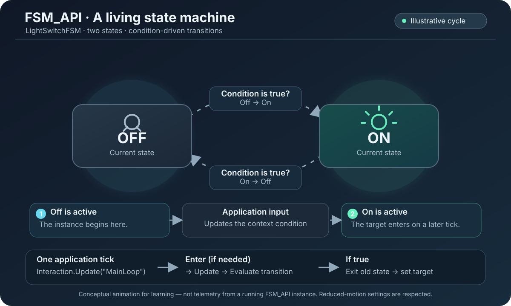
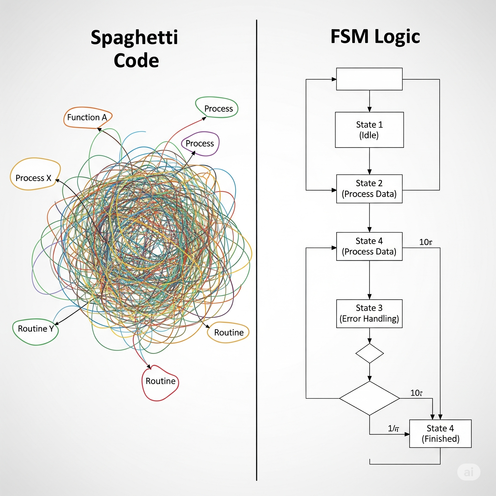
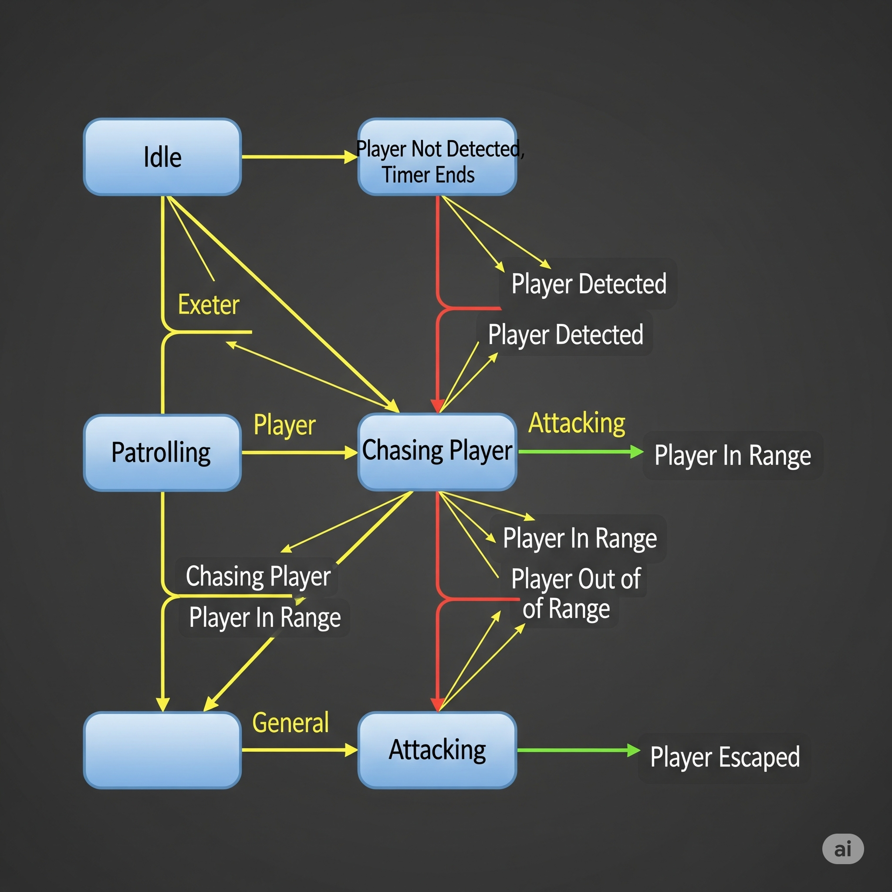
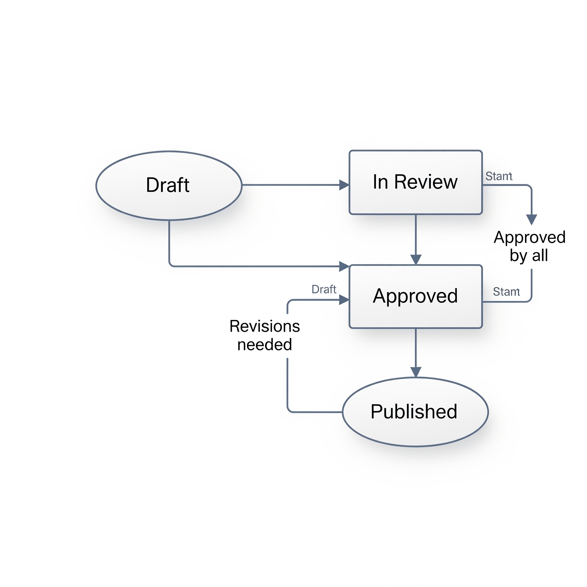

# 00. Introduction to FSM_API

## 📚 Table of Contents

[00. Introduction to FSM_API](00_Introduction.md)

[01. Core Concepts: Your Guide to FSM_API](01_Core_Concepts.md)

[03. Getting Started with C# ](03_Getting_Started_CSharp.md)

[04. FSMBuilder Deep Dive: Building Your FSMs](04_FSM_Builder_Deep_Dive.md)

[05. Understanding and Implementing Your Context (IStateContext)](05_Context_Implementation.md)

[06. FSMModifier Deep Dive: Modifying Your FSMs at Runtime](06_FSM_Modifier_Deep_Dive.md)

[07. Robust Error Handling: Cascading Degradation System](07_Error_Handling.md)

[08. Performance Tips & Best Practices](08_Performance_Tips.md)

[09. Common Use Cases & Examples](09_Common_Use_Cases.md)

[10. FSM_API for Non-Coders: A Big Picture Overview](10_Non_Coder_Overview.md)

[11. Frequently Asked Questions (FAQ)](11_FAQ.md)

### FSM theory — concepts beyond the API

[01. What Are Finite State Machines (FSMs)? — A Deeper Dive](Theory/01_What_Are_FSMs.md) · [02. Types of FSMs: Mealy, Moore, Hierarchical, and Concurrent](Theory/02_Types_Of_FSMs.md) · [03. Advantages and Disadvantages of Using FSMs](Theory/03_Advantages_And_Disadvantages.md) · [04. When to Use Finite State Machines](Theory/04_When_To_Use_FSMs.md) · [05. FSM Limitations and Alternatives](Theory/05_FSM_Limitations_And_Alternatives.md) · [06. Tick boundaries, deferred work, and registry ownership](Theory/06_Tick_Boundaries_And_Registry_Ownership.md)

---

## 👋 Welcome to FSM_API!

FSM_API is a powerful, performance-driven library designed to help you easily manage complex behaviors in your applications and games using **Finite State Machines (FSMs)**. It provides a robust and flexible framework for defining, managing, and executing state-based logic.

<em>This is an illustrative animation of the state cycle, not a live process monitor. The current state changes only when a transition condition is satisfied; the next state's enter action runs on the subsequent tick. Prefer a static image? The original [LightSwitch diagram](Visuals/Light_Switch_FSM.png) remains available.</em>

### See the same idea in a small, real C# demo

  

The fox-and-dog visual is paired with actual FSM_API C# examples in [SimpleDemos](https://github.com/TrentBest/SimpleDemos): [fox states and transition predicates](https://github.com/TrentBest/SimpleDemos/blob/master/QuickBrownFox/QuickBrownFox.cs), [dog states and cross-FSM transition request](https://github.com/TrentBest/SimpleDemos/blob/master/QuickBrownFox/LazySleepingDog.cs), and the [application update loop](https://github.com/TrentBest/SimpleDemos/blob/master/QuickBrownFox/Program.cs). The SVG is a conceptual animation; the C# code remains the authority for executable behavior.

---

## 🎯 Why and Where Can You Use FSM_API?

FSM_API can be used anywhere you need structured, predictable, and maintainable state-driven logic. Its applications span numerous domains:

    Application & System Logic: Manage complex workflows like a document moving from Draft to Review to Published. Control UI states, such as enabling or disabling form elements based on user progress. Build robust data processing pipelines or manage the lifecycle of network connections.

    AI & Agent Behavior: Define the logic for any autonomous entity, whether it's an enemy in a game (Patrolling, Chasing, Attacking) or a robot in a warehouse (Charging, Fetching Item, Returning to Base).

    Interactive Systems: Control the states of any interactive object, such as a door (Open, Closed, Locked) or a vending machine (Idle, Awaiting Selection, Dispensing).

Its benefits include:
* **Performance-Driven:** Designed for **efficiency** and **responsiveness**, even when managing **hundreds or thousands** of active state machines.
* **Clarity & Maintainability:** Designed for **readability and elegance**, FSM_API helps teams collaborate with ease and maintain codebases confidently.

<em>Transform tangled logic into a clear, manageable flow.</em>
* **Testability:** FSM_API’s clean **separation of logic and context** makes it easy to write **automated unit tests** for your state machines.

*A concrete example of an FSM for character AI.*

<em>An FSM for enemy AI in a game.</em>

<em>An FSM for a document workflow in a business application.</em>

---

## 📚 Where to Go Next?

To best navigate this documentation, please consider your current understanding:

* **New to Finite State Machines (FSMs)?**
    If terms like "states," "transitions," "event-driven," or "stepped" are new to you, begin with our **Theory folder** for comprehensive explanations and definitions:
    * **[Theory/01_What_Are_FSMs.md](Theory/01_What_Are_FSMs.md)**
    * **[Theory/02_Types_Of_FSMs.md](Theory/02_Types_Of_FSMs.md)**
    * **[Theory/03_Advantages_And_Disadvantages.md](Theory/03_Advantages_And_Disadvantages.md)**
    * **[Theory/04_When_To_Use_FSMs.md](Theory/04_When_To_Use_FSMs.md)**
    * **[Theory/05_FSM_Limitations_And_Alternatives.md](Theory/05_FSM_Limitations_And_Alternatives.md)**

* **Familiar with FSMs, but new to FSM_API?**
    For an abridged overview of how FSM_API implements core FSM concepts, proceed to the **[01. Core Concepts: Your Guide to FSM_API](01_Core_Concepts.md)** section.

* **Ready to start coding?**
    Jump straight into our C# guide: **[03. Getting Started with c#](03_Getting_Started_CSharp.md)**.

* **Are you a non-coder looking for a high-level understanding?**
    Get a broad overview of what FSM_API does and its benefits without diving into code in **[10. FSM_API for Non-Coders: A Big Picture Overview](10_Non_Coder_Overview.md)**.

---

[➡️ Continue to: 01. Core Concepts: Your Guide to FSM_API](01_Core_Concepts.md)

**Support the project:** [**Donate via PayPal**](https://www.paypal.com/donate/?hosted_button_id=3Z7263LCQMV9J)