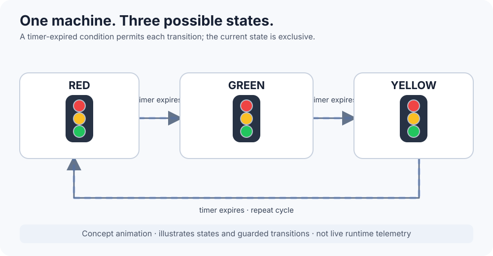

<!-- The Singularity Workshop moniker -->
<p align="center"><a href="https://github.com/TrentBest"></a></p>

# 01. What Are Finite State Machines (FSMs)? — A Deeper Dive

Before learning the term *finite-state machine*, notice how often you already reason about states.

- A **door** may be closed, opening, open, or closing. The same button press can mean something different depending on the door's current condition.
- An **online order** may be drafted, submitted, paid, shipped, delivered, or cancelled. Not every next step is legal from every stage.
- A **phone connection** may be disconnected, connecting, connected, or reconnecting. A failed connection changes what should happen next.
- A **person** may be waiting, boarding, travelling, or disembarking. Each phase permits different actions.
- A **traffic light** cycles through defined phases. Its current phase determines which transition is appropriate when its timer expires.

You do not need to be a programmer to understand the pattern. You are already asking four useful questions: **What situation is it in now? What can happen next? What condition allows that change? What should the system do in this situation?**

<a href="Visuals/Everyday_State_Model.svg" target="_blank">
  
</a>

*This is a teaching model, not a complete door controller. A real installation must also define obstruction detection, interlocks, sensor failure behavior, emergency stops, and safe motor control.*

## From intuition to a formal model

A **Finite State Machine (FSM)** is a mathematical model of behavior with a finite set of states and defined rules for changing between them. A conventional FSM occupies one of its defined states at a time. A change from one state to another is called a **transition**. A basic model identifies its states, initial state, and transition rules; particular FSM formalisms may add outputs, accepting states, or other structure.

The FSM is a *model of the thing*, not the thing itself. The model of a door does not move the door's motor; the application supplies sensors, timing, safety interlocks, and physical actions. FSM_API executes the behavior you define, while your application owns its domain data and external effects.

This document builds from everyday intuition into the formal vocabulary and then connects that theory to FSM_API. For a gentler first pass, start with the [non-coder overview](../10_Non_Coder_Overview.md).

---

## Continue the learning path

Return to the [FSM_API Theory learning path](README.md) for the complete chapter sequence and implementation links.

---

## ⚛️ The Core Components of an FSM

Every Finite State Machine, regardless of its complexity, is built upon a few fundamental components:

### 1. **States**
A state represents a particular situation, condition, or mode that a system can be in.
* **Finite Number:** Crucially, there must be a defined, limited number of possible states. For example, a traffic light only has Red, Yellow, and Green.
* **Exclusive:** An FSM can only be in one state at any given moment. It cannot be in two states simultaneously.
* **Representation:** States often correspond to discrete behaviors or phases (e.g., `Idle`, `Walking`, `Attacking` for a game character; `Open`, `Closed`, `Opening` for a door).

### 2. **Transitions**
A transition is a change from one state to another.
* **Triggered by Events/Conditions:** Transitions occur in response to specific `events` (e.g., a button press, a network message received) or when certain `conditions` become true (e.g., health drops below a threshold, a timer expires).
* **Directional:** Transitions typically move in one direction (e.g., `Green` to `Yellow`, but not directly `Green` to `Red`).
* **Atomic:** A transition is an instantaneous jump from one state to the next.

### 3. **Initial State**
Every FSM must have a designated starting state. This is the state the machine enters when it is first created or initialized.

### 4. **Optional: Final/Accepting States**
While not always present in all FSM applications (especially in continuous systems like game AI), in formal automata theory, some FSMs have "final" or "accepting" states. Reaching one of these states signifies the successful completion of a process or the recognition of a valid input sequence.

---

## 🚦 A Simple Example: The Traffic Light

Let's illustrate with the classic example: a traffic light.

* **States:**
    * `Red`
    * `Green`
    * `Yellow`
* **Initial State:** Let's say it starts at `Red`.
* **Transitions:**
    * From `Red`: When a timer expires, transition to `Green`.
    * From `Green`: When a timer expires, transition to `Yellow`.
    * From `Yellow`: When a timer expires, transition to `Red`.

<a href="Visuals/TrafficLightFSM.svg" target="_blank">
    
</a>
<em>The animation illustrates the repeating state sequence. It is a teaching aid, not a live traffic controller or FSM_API process monitor. The original [static diagram](Visuals/TrafficLightFSM.png) remains available.</em>

In this diagram:
* Circles represent **States**.
* Arrows represent **Transitions**.
* Labels on arrows represent the **Conditions/Events** that trigger the transition.

---

## From the diagram to executable C#

The diagram is a model of the behavior. FSM_API lets us express that model as C#; the application still owns the real-world input and timing. In this small example, the host updates `TimerExpired` when its timer completes, then asks the processing group to update. The FSM definition describes which state may follow which.

```csharp
using TheSingularityWorkshop.FSM_API;

const string group = "TrafficLight";
const string definition = "TrafficLightFSM";

FSM_API.Create.CreateProcessingGroup(group);

FSM_API.Create
    .CreateFiniteStateMachine(definition, processRate: 1, processingGroup: group)
    .State("Red")
    .State("Green")
    .State("Yellow")
    .WithInitialState("Red")
    .Transition("Red", "Green", ctx => ((TrafficLightContext)ctx).TimerExpired)
    .Transition("Green", "Yellow", ctx => ((TrafficLightContext)ctx).TimerExpired)
    .Transition("Yellow", "Red", ctx => ((TrafficLightContext)ctx).TimerExpired)
    .BuildDefinition();

var trafficLight = new TrafficLightContext();
FSMHandle handle = FSM_API.Create.CreateInstance(definition, trafficLight, group);

// The host owns the timer and decides when this becomes true.
trafficLight.TimerExpired = true;
FSM_API.Interaction.Update(group);

public sealed class TrafficLightContext : IStateContext
{
    public bool IsValid => true;
    public string Name { get; set; } = "Intersection A";
    public bool TimerExpired { get; set; }
}
```

This is the **state graph**, not a complete traffic controller: production code must own timer scheduling, reset the timer after a transition, and apply safety requirements. The example deliberately makes that boundary visible instead of hiding timing inside the diagram.

## Could this be shown through TheSingularityWorkshop.GUI?

**Yes, architecturally—by composing your existing technologies, not by making FSM_API depend on a renderer.** Your [GUI repository](https://github.com/TrentBest/TheSingularityWorkshop.GUI) separates a platform-neutral semantic `GuiNode` tree from its Blazor and WPF manifestations. That gives us a sensible path:

1. **FSM_API** owns state definitions, transition evaluation, runtime state, and processing.
2. **An observation/diagnostic boundary** exposes selected, read-only runtime facts such as active state, transition history, and update events.
3. **GUI.Core** builds a semantic view of those facts; it does not need to know whether the screen is a browser or desktop.
4. **GUI.Blazor / GUI.WPF** render that view on their respective platforms.

The animated SVG on this page is currently a **teaching animation** with a pre-authored sequence. It is not connected to a running FSM. A true live highlight would require a supported observation contract and a consumer that updates the semantic GUI when runtime events arrive. We should not pretend that such a feed exists until it is implemented and tested.

### Where the limits are

- **Possible now:** C# examples and definitions; static and pre-authored animated diagrams; documentation linking the model to real API calls.
- **Possible with integration work:** a live inspector that highlights the actual current state and traversed transition, driven by real FSM_API observations and rendered through GUI.Core + platform adapters.
- **Not automatic:** a diagram cannot infer arbitrary application-owned inputs, timers, external effects, or domain meaning unless the application exposes them.
- **Important boundary:** FSM_API should remain independent of GUI.Core, Blazor, WPF, browser DOM, and styling. A diagnostic adapter or optional integration package can connect them without reversing the dependency direction.
- **Current GUI project limits:** the GUI repository documents some future contracts—such as stable semantic interaction, capability negotiation, and shared adapter conformance—as not yet implemented. We should build on the contracts that exist rather than assume the roadmap is already runtime capability.

This is the larger opportunity: one behavior definition can be explained in theory, expressed in C#, and eventually observed through your own GUI system—while each layer keeps a clear responsibility.

## 💾 Why FSMs are Powerful

The beauty of FSMs lies in their simplicity and power:

* **Clarity and Predictability:** They provide a very clear, easy-to-understand model of behavior. You can always know what the system is doing and what it *can* do next.
* **Organized Logic:** By segmenting logic into distinct states, complex behaviors become modular and manageable. Instead of one giant block of "if-else-if" statements, you have specialized logic for each state.
* **Reduced Bugs:** The strict rules for state transitions prevent illogical or impossible states, significantly reducing unexpected bugs.
* **Testability:** Each state and transition can be tested in isolation, making debugging and validation much easier.
* **Maintainability and Extensibility:** Adding new behaviors or modifying existing ones often means simply adding a new state or transition, rather than re-architecting large portions of your code.

FSM_API provides the tools to build these powerful, organized, and reliable state machines right into your C# applications, whether you're working on complex game AI, intricate UI interactions, or robust backend workflows.

---

[➡️ Continue to: 02. Types of FSMs: Mealy, Moore, Hierarchical, and Concurrent](02_Types_Of_FSMs.md)

**Support the project:** [**Donate via PayPal**](https://www.paypal.com/donate/?hosted_button_id=3Z7263LCQMV9J)

---

<!-- THE SINGULARITY WORKSHOP FOOTER -->
<p align="center"></p>
