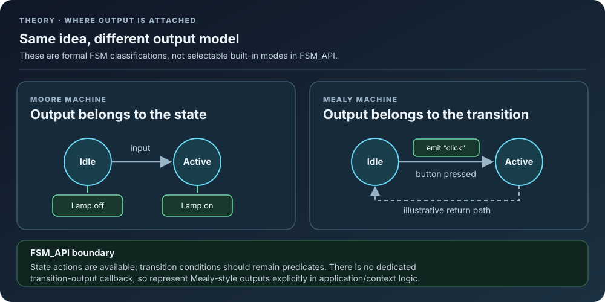
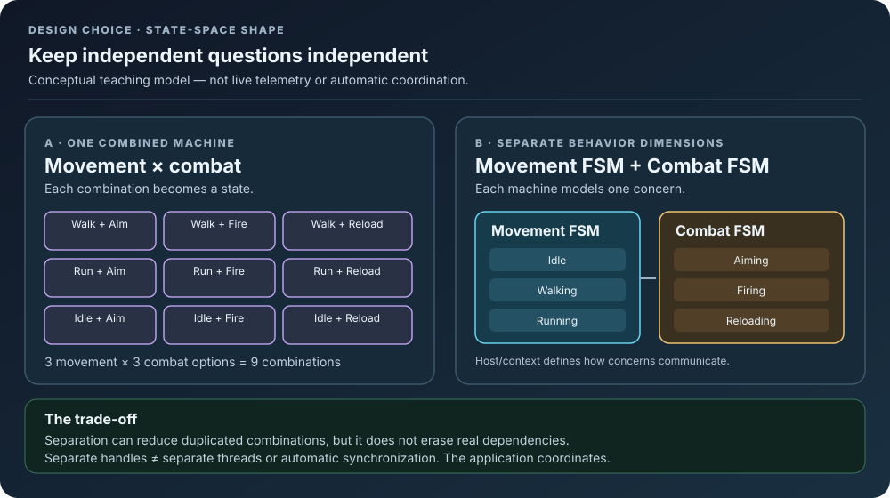

# 02. Types of FSMs: Mealy, Moore, Hierarchical, and Concurrent

> While all Finite State Machines share the core concepts of states and transitions, their specific behavior and structure can vary. Understanding these different types allows you to choose the most appropriate FSM model for your particular problem, from simple reactive systems to highly complex, adaptive behaviors.

This document explores the common classifications and architectural patterns of FSMs.

---

## 📚 Table of Contents (for Theory Folder)

* [01. What Are Finite State Machines (FSMs)? - A Deeper Dive](01_What_Are_FSMs.md)
* [02. Types of FSMs: Mealy, Moore, Hierarchical, and Concurrent](02_Types_Of_FSMs.md)
* [03. Advantages and Disadvantages of Using FSMs](03_Advantages_And_Disadvantages.md)
* [04. When to Use Finite State Machines](04_When_To_Use_FSMs.md)
* [05. FSM Limitations and Alternatives](05_FSM_Limitations_And_Alternatives.md)
* [06. Tick boundaries, deferred work, and registry ownership](06_Tick_Boundaries_And_Registry_Ownership.md)

---

## 🔬 Fundamental Types: Mealy vs. Moore Machines

These are two classic, foundational types of FSMs, primarily differing in when and how they produce an **output**.

### 1. **Moore Machines** 🎭

In a **Moore Machine**, the **output is associated solely with the state itself**. When the FSM enters a state, it produces that state's defined output. The output *only* changes when the state changes.

* **Characteristics:**
    * Outputs are tied to **states**.
    * Simpler to design and understand because the output is predictable once you know the current state.
    * One common use for Moore machines is in vending machine logic where the action (e.g., dispensing a drink) happens *after* the correct state (e.g., "Enough Money Deposited") is reached.
* **Analogy:** Think of a radio with a display showing "Playing Music" or "On Standby." The display (output) reflects the current mode (state) of the radio.
* **FSM_API Relevance:** The `onEnter` and `onExit` actions in FSM_API states are highly aligned with the Moore machine concept, as they execute code *upon entering* or *exiting* a state. The `onUpdate` is also state-dependent.

---

### 2. **Mealy Machines** ⚙️

In a **Mealy Machine**, the **output is associated with the transitions between states**. An output is produced when a particular transition occurs, meaning the same state might lead to different outputs depending on *how* it was entered or *what transition* is taken out of it.

* **Characteristics:**
    * Outputs are tied to **transitions**.
    * Can often have fewer states than a Moore machine for the same functionality because outputs are more granular.
    * More flexible in expressing complex behaviors where an action is directly dependent on the *event* that causes a state change.
* **Analogy:** Imagine a simple doorbell. The "ringing" sound (output) happens *during* the transition from "Button Not Pressed" to "Button Pressed," not while the button is just "Pressed."
* **FSM_API relevance and boundary:** FSM_API exposes transition conditions as predicates and state actions such as `OnEnter`, `OnUpdate`, and `OnExit`; this API surface does not provide a dedicated transition-output callback. Keep transition conditions focused on answering whether a transition is allowed—do not use them for output side effects, because the predicate may be evaluated as part of transition selection. Mealy-style outputs therefore need to be modeled explicitly in context/state logic or represented by a state structure that makes the output unambiguous. That is a modeling choice, not a native Mealy-machine mode.

---

## 🌳 Advanced Architectures

Beyond the fundamental Mealy and Moore models, FSMs can be structured in more complex ways to manage intricate behaviors.

### 3. **Hierarchical State Machines (HSMs)** 🌲

Also known as **nested FSMs**, HSMs allow states to contain their own sub-FSMs. This introduces the concept of **superstates** and **substates**.

* **Superstate (Parent State):** A state that contains an entire FSM within it. When the parent FSM enters a superstate, the sub-FSM inside it becomes active and enters its own initial state.
* **Substate (Child State):** A state within a superstate's FSM.
* **Benefits:**
    * **Reduced Complexity:** Breaking down a large FSM into smaller, manageable sub-FSMs makes design and debugging much easier.
    * **Code Reusability:** Common behaviors (e.g., `Attacking` in both `MeleeCombat` and `RangedCombat` superstates) can be represented once in a sub-FSM.
    * **Easier Global Transitions:** A transition out of a superstate means exiting *any* of its substates and moving to a new state in the parent FSM, simplifying global exits (like a "Stunned" state interrupting any combat action).
* **FSM_API Relevance:** FSM_API can support Hierarchical FSMs by having separate FSM definitions that are activated/deactivated by the `onEnter` and `onExit` methods of a parent FSM's states. Your context object (IStateContext) would typically manage the active sub-FSM handle.

---

### 4. **Concurrent (Parallel) State Machines** 👯

Concurrent FSMs allow a system to be in **multiple states simultaneously**, with each FSM controlling a different, independent aspect of the system's behavior.

* **Characteristics:**
    * Instead of one FSM for an entire entity, you have multiple FSMs running in parallel for that same entity.
    * Each concurrent FSM manages a distinct aspect (e.g., `MovementFSM`, `CombatFSM`, `AnimationFSM`, `InventoryFSM`).
    * These FSMs might interact by reading each other's current states or by sending events.
* **Benefits:**
    * **Modularity:** Clearly separates different behavioral concerns.
    * **Flexibility:** Allows for more complex combinations of behaviors than a single, monolithic FSM.
    * **Scalability:** Easier to add or remove independent behaviors without affecting others.
* **FSM_API relevance and boundary:** You can create multiple FSM handles and have them operate on the same context object when appropriate. Each handle represents a separate machine, not a built-in parallel-thread system. Processing-group names determine which instances are selected when the host calls the corresponding update; the host still controls tick order and cadence, and the application must define how behaviors coordinate and share data.

*Visual model:* a flat combined machine can multiply state combinations; separate machines can reduce duplication when concerns are genuinely independent. This is a modeling comparison, not a guarantee that separate FSMs can always be composed safely.

---

By understanding these different types, you can leverage FSM_API to build systems that are not only robust and performant but also elegant and maintainable, regardless of their behavioral complexity.

---

[➡️ Continue to: 03. Advantages and Disadvantages of Using FSMs](03_Advantages_And_Disadvantages.md)

**Support the project:** [**Donate via PayPal**](https://www.paypal.com/donate/?hosted_button_id=3Z7263LCQMV9J)