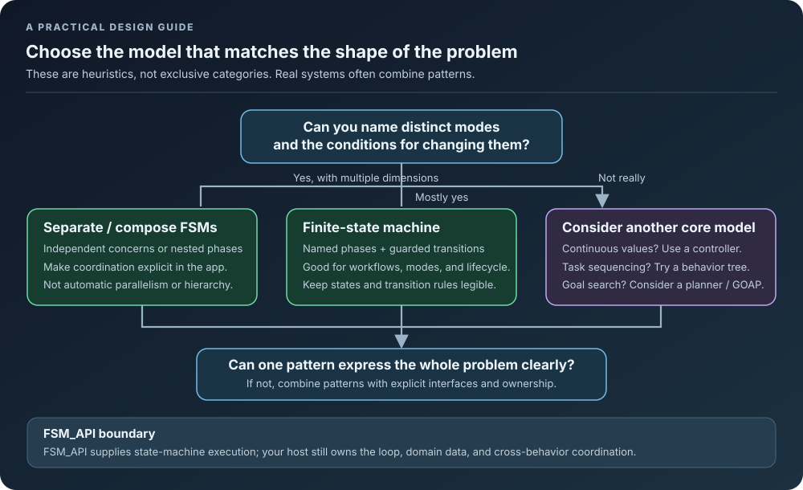

<!-- The Singularity Workshop moniker -->

# 04. When to Use Finite State Machines

> Finite State Machines (FSMs) are not a silver bullet for every programming problem, but they are an incredibly powerful and elegant solution for specific types of challenges. This document outlines common scenarios and characteristics of problems where employing an FSM, especially with FSM_API, will yield significant benefits in terms of clarity, maintainability, and robustness.

---

## Continue the learning path

Return to the [FSM_API Theory learning path](README.md) for the complete chapter sequence and implementation links.

---

## 🧭 A quick model-selection guide

Use the diagram as a starting point, not a rigid rule. FSMs can be combined with controllers, behavior trees, and planners when each has a clear responsibility.

## 🎯 Ideal Scenarios for FSM Implementation

Consider using an FSM when your system or entity exhibits one or more of the following characteristics:

### 1. **Discrete, Well-Defined States** 🚦
The system can clearly be in one of a finite number of distinct modes or conditions.
* **Examples:** A traffic light (Red, Yellow, Green), a user's login status (Logged Out, Logging In, Logged In, Failed Login), a door (Open, Closed, Opening, Closing).
* **Why FSMs Shine:** FSMs naturally map to these discrete states, enforcing that the system is *only* in one state at a time, making behavior predictable.

### 2. **State-Dependent Behavior** 🚶‍♀️⚔️
The system's actions, valid inputs, or responses change significantly based on its current state.
* **Examples:** A game character can only `Attack` if it's in the `Idle` or `Attacking` state, not `Stunned`. A button is only `Clickable` if the application is in the `Ready` state.
* **Why FSMs Shine:** FSMs encapsulate state-specific logic, preventing invalid actions and simplifying the code for each mode.

### 3. **Event-Driven Transitions** ⚡
Changes between states occur in response to specific events or conditions being met.
* **Examples:** A player character transitions from `Idle` to `Walking` when an "input received" event occurs. A download manager transitions from `Downloading` to `Completed` when a "download finished" event fires.
* **Why FSMs Shine:** FSMs provide a clear, structured way to define what triggers a state change, improving clarity over scattered conditional logic.

### 4. **Complex Conditional Logic Tied to Behavior** 🌳
When you find yourself writing many nested `if-else if` statements to manage an entity's behavior that is difficult to untangle.
* **Example:** An AI's decision-making process involving multiple factors like health, distance to target, current enemy count, and ammunition, all influencing its next action.
* **Why FSMs Shine:** FSMs break down this complexity into manageable states, where each state focuses on a subset of the logic, leading to cleaner, more readable code.

### 5. **Clear Lifecycle or Workflow Stages** 🔄
Processes that move through a defined sequence of steps or phases.
* **Examples:** An order processing system (Pending, Confirmed, Shipped, Delivered), a build process (Compiling, Linking, Testing, Deploying).
* **Why FSMs Shine:** FSMs provide a visual and programmatic blueprint for these workflows, ensuring steps are followed correctly and transitions are valid.

### 6. **When You Need a Visual Representation** 📊
For systems where it's beneficial to communicate behavior clearly to both technical and non-technical team members.
* **Examples:** Game designers, product managers, or QA testers need to understand AI behavior or UI flow without reading code.
* **Why FSMs Shine:** FSMs are easily visualized as state diagrams, serving as excellent documentation and communication tools.

### 7. **Managing Concurrent or Hierarchical Behaviors (with advanced FSMs)** 👯‍♀️🌲
When a single entity has multiple independent behaviors running in parallel, or when states naturally nest within each other.
* **Examples:** A game character can be simultaneously `Walking` (movement FSM) and `Reloading` (combat FSM). Or, a character's `Combat` superstate contains `Attacking`, `Defending`, and `Dodging` substates.
* **Why FSMs can help:** Multiple independent FSM_API handles can separate concerns such as movement, combat, and animation, while separate definitions can be coordinated as a hierarchy by application code. These are composition patterns built with handles, contexts, state actions, and processing groups—not automatic hierarchical-state semantics or a guarantee of parallel-thread execution. They improve modularity when the behaviors and their coordination rules are explicit.

---

## ✅ FSM_API's Strengths in These Scenarios

FSM_API is specifically engineered to excel in these contexts by providing:

* **Clean Separation (IStateContext):** Ensures your FSM logic is reusable and decoupled from your specific game objects or data models.
* **Performance:** The library provides processing groups and per-instance execution, but actual throughput and allocations depend on workload and host scheduling. Benchmark representative scenarios before making performance claims.
* **Error handling:** FSM_API has instance-error handling and configurable threshold behavior, but it does not guarantee that every exception is contained or that the host application cannot fail. Read the [error-handling guide](../07_Error_Handling.md) for the exact boundaries.
* **Portability:** The core library is pure C# and engine-agnostic; engine-specific behavior belongs in integration packages or application code.

By recognizing these patterns in your problem domain, you can effectively leverage FSM_API to build more organized, predictable, and maintainable software.

---

[➡️ Continue to: 05. FSM Limitations and Alternatives](05_FSM_Limitations_And_Alternatives.md)

**Support the project:** [**Donate via PayPal**](https://www.paypal.com/donate/?hosted_button_id=3Z7263LCQMV9J)

---

<!-- THE SINGULARITY WORKSHOP FOOTER -->

