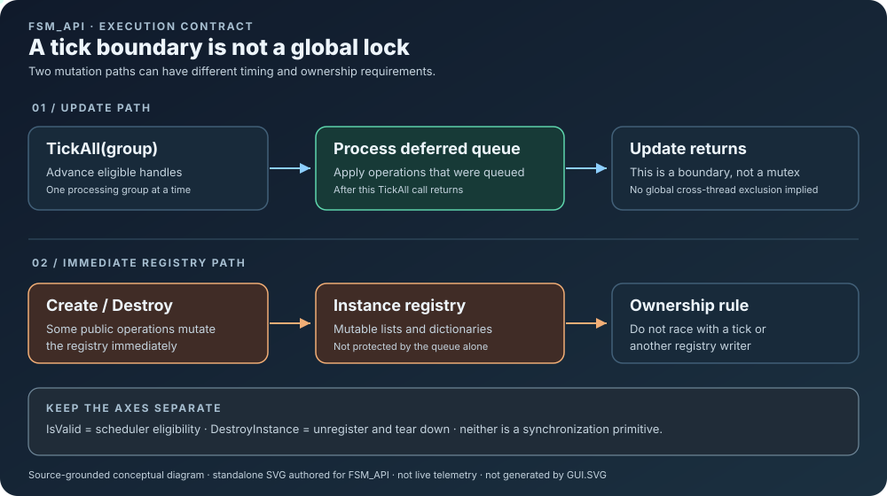

# Tick boundaries, deferred work, and registry ownership

This implementation-focused chapter is part of the [FSM_API Theory learning path](README.md).

FSM_API has a useful deferred-mutation mechanism, but **a deferred queue is not a global lock**. Understanding that distinction matters when a host updates or disposes instances.

*Source-grounded conceptual diagram. It describes the implementation contract; it is not live telemetry and was authored as standalone SVG, not generated through GUI.SVG.*

## What an Update call guarantees

The public `Interaction.Update(processingGroup)` path calls `Internal.TickAll(processingGroup)` and then `Internal.ProcessDeferredModifications()`. This gives queued work a processing boundary after that group's tick.

It does **not** mean every structural operation is queued, and it does not synchronize arbitrary calls from other threads or overlapping ticks.

## Two paths, different timing

- **Queued mutation:** operations that explicitly use the deferred queue—such as the current `Interaction.MoveInstance` path—are applied when the queue is processed after the tick.
- **Immediate registry mutation:** creation inserts into the processing group's instance list immediately; `Interaction.DestroyInstance` calls the internal destroy path directly. Other lifecycle operations can also walk and alter registry structures immediately.

Because the registry contains mutable dictionaries and lists, callers must not allow immediate registry mutation to race with ticking or another registry mutation. The queue does not make unsynchronized access safe by itself.

## Lifecycle is a separate axis

`FSMHandle.IsValid` reflects `Context.IsValid`. Setting it false suspends scheduler processing while preserving registration; restoring validity can resume the same handle. Explicit `DestroyInstance` is a different operation: it removes and tears down the handle.

Do not use `IsValid` as proof that a handle is registered, destroyed, or safe to dispose. Do not treat deactivation as cleanup.

## Investigating an integration failure

When a consumer reports an exception during disposal:

1. Identify the exact call path and the thread that owns the update/tick.
2. Check whether disposal can overlap a tick, another destroy, or definition/group removal.
3. Trace every writer of the relevant registry list—not only the line that threw.
4. Build a deterministic regression test for the confirmed interleaving before changing synchronization semantics.

A stack trace is evidence of where a failure surfaced, not by itself proof of which competing operation caused it.

## Source references

- `FSM_API.Interaction.Update` and `Internal.TickAll`
- `Internal.ProcessDeferredModifications` and `Internal.QueueDeferredModification`
- `Create.CreateInstance`, `Interaction.MoveInstance`, and `Interaction.DestroyInstance`
- [Handle validity and lifecycle](../../Design/FSM_API/FSM_API/FSMHandle/FSMHandle.md)
- [Renderer integration investigation](../../../RendererLLM.md)

The implementation and regression tests are authoritative. Revisit this document whenever the registry ownership or deferred-mutation contract changes.

---

<!-- THE SINGULARITY WORKSHOP FOOTER -->

