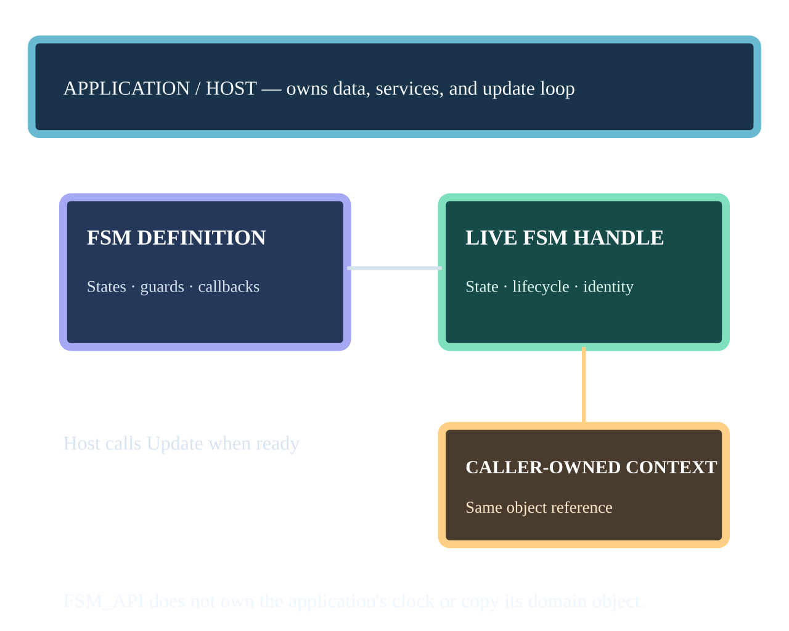
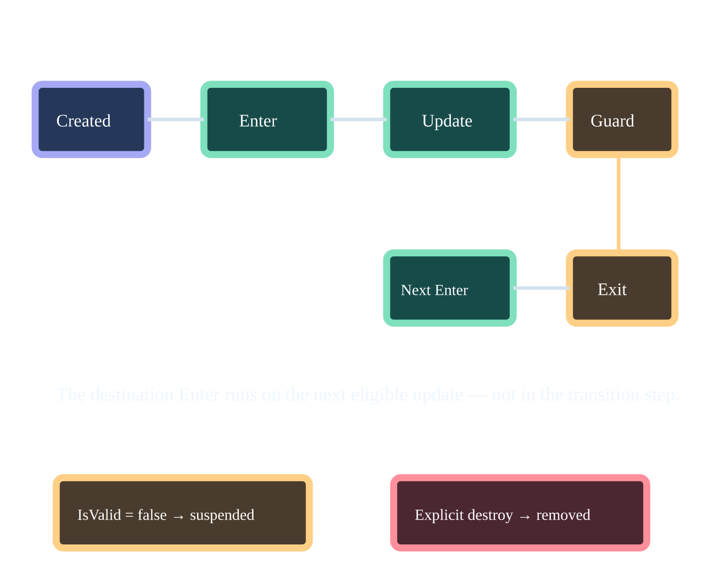
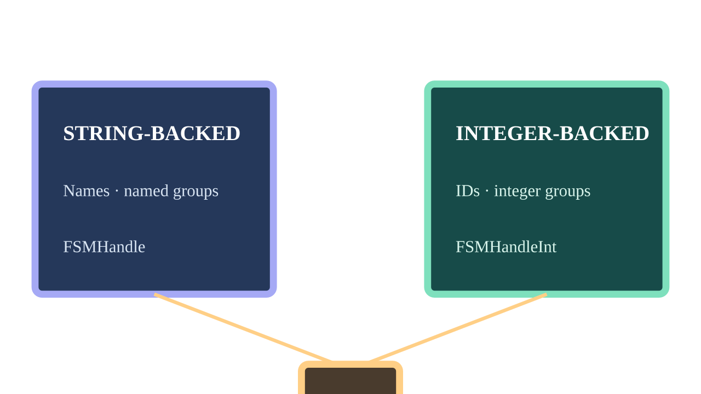
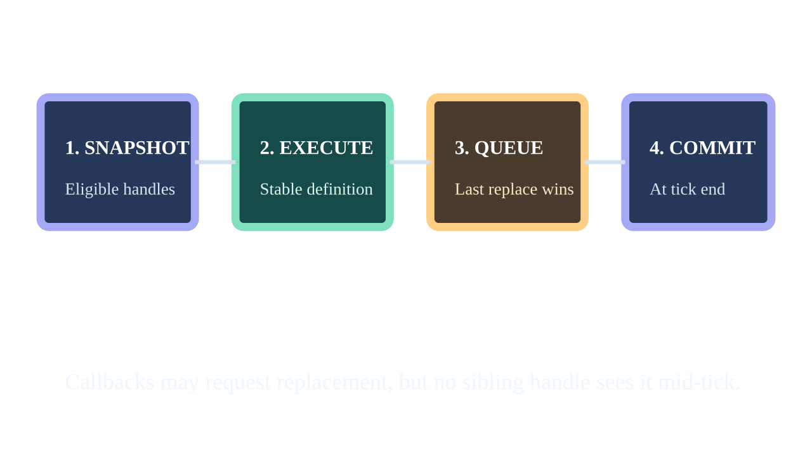

# FSM_API living visuals

These visuals are generated from semantic GUI trees by **GUI.SVG**, the SVG interoperability adapter in [TheSingularityWorkshop.GUI](https://github.com/TrentBest/TheSingularityWorkshop.GUI). FSM_API owns the behavior model; GUI Core owns the semantic scene description; GUI.SVG manifests that description as SVG. The SVG is a documentation artifact, not a second runtime or an authoritative execution clock.

## Generated visual set

| Artifact | What it teaches | Source of truth |
| --- | --- | --- |
| `fsm-api-ownership.svg` | Host, caller-owned context, definition, handle, and API responsibilities | FSM_API ownership contract |
| `fsm-api-lifecycle.svg` | Enter, Update, transition, Exit, next-tick Enter, suspension, and explicit destruction | Runtime lifecycle tests and tick contract |
| `fsm-api-representations.svg` | Separate string/integer registries and explicit Transfer boundary | Public API contract and facade |
| `fsm-api-tick-boundary.svg` | Tick snapshot, queued replacement, lifecycle finalization, and boundary commit | Tick-boundary regression tests |

## Generated diagram gallery

### Ownership and responsibility

### Lifecycle and transition timing

### String and integer representations

### Tick consistency boundary

## Animated storyboards

The generated storyboard set teaches behavior as a sequence rather than a static inventory:

| Artifact | Sequence | Invariant taught |
| --- | --- | --- |
| `fsm-api-add-state.svg` | S0 exists → S1 appears as a dashed proposal → S1 resolves into the definition | Adding a state does not erase existing states |
| `fsm-api-state-transition.svg` | S0 is active → transition is traversed → S1 becomes current | Exit runs for the old state; destination Enter waits for the next eligible update |
| `fsm-api-tick-atomic-mutation.svg` | Snapshot → execute → queue replacement → commit at boundary | Sibling handles do not observe a half-applied replacement |

These sequences are generated by `VisualSequences.cs`. Their shared authoring rules and review checklist are in [the visual storytelling contract](VISUAL_STORYTELLING_CONTRACT.md).

### Add a state

### Execute a transition

### Replace a definition during a tick

## Generation contract

The generator must use `GuiBuilder` from `TheSingularityWorkshop.GUI.Core` and `SvgGuiRenderer` from `TheSingularityWorkshop.GUI.SVG`. It must not hand-author SVG XML or infer behavior from the artwork. For a local run, clone `TheSingularityWorkshop.GUI` into the `TheSingularityWorkshop.GUI` subdirectory at the FSM_API repository root, then run `dotnet run --project Documentation/Visuals/FsmApiVisuals.csproj --configuration Release`. Every label and edge must correspond to a documented API or tested runtime rule.

The generator workflow pins GUI to [commit b4268c8db4e69908fb0b876f081aa323497d00d3](https://github.com/TrentBest/TheSingularityWorkshop.GUI/commit/b4268c8db4e69908fb0b876f081aa323497d00d3) so a documentation build is reproducible. Updating that pin is an intentional dependency change: review the adapter contract, regenerate the diagrams, and inspect the output before changing it.

The pinned GUI source's SVG adapter guide and runnable gallery are the implementation reference:

- [GUI.SVG adapter contract](https://github.com/TrentBest/TheSingularityWorkshop.GUI/blob/b4268c8db4e69908fb0b876f081aa323497d00d3/docs/SVG_ADAPTER.md)
- [Semantic-tree-to-SVG use case](https://github.com/TrentBest/TheSingularityWorkshop.GUI/blob/b4268c8db4e69908fb0b876f081aa323497d00d3/docs/USE_CASES/01-SEMANTIC-TREE-TO-SVG.md)
- [Runnable SVG gallery generator](https://github.com/TrentBest/TheSingularityWorkshop.GUI/blob/b4268c8db4e69908fb0b876f081aa323497d00d3/samples/SvgGallery/Program.cs)

The generated assets should be reviewed as images as well as XML. XML validity alone cannot detect clipped labels, overlapping arrows, unreadable contrast, or misleading spatial relationships.

## Important boundaries

- Declarative SVG animation is viewer-interpreted. It is not an FSM_API update loop.
- GUI.SVG serializes supplied references; it is not a URL sanitizer. Use controlled local documentation scenes and do not treat XML escaping as SVG security sanitization.
- General scene geometry and Visualizer frames belong to Visualize. GUI.SVG is used here because these diagrams are semantic documentation interfaces.
- Regenerate an image whenever the API contract, lifecycle ordering, identity boundary, or relevant test changes. Review the source and generated artifact together.
