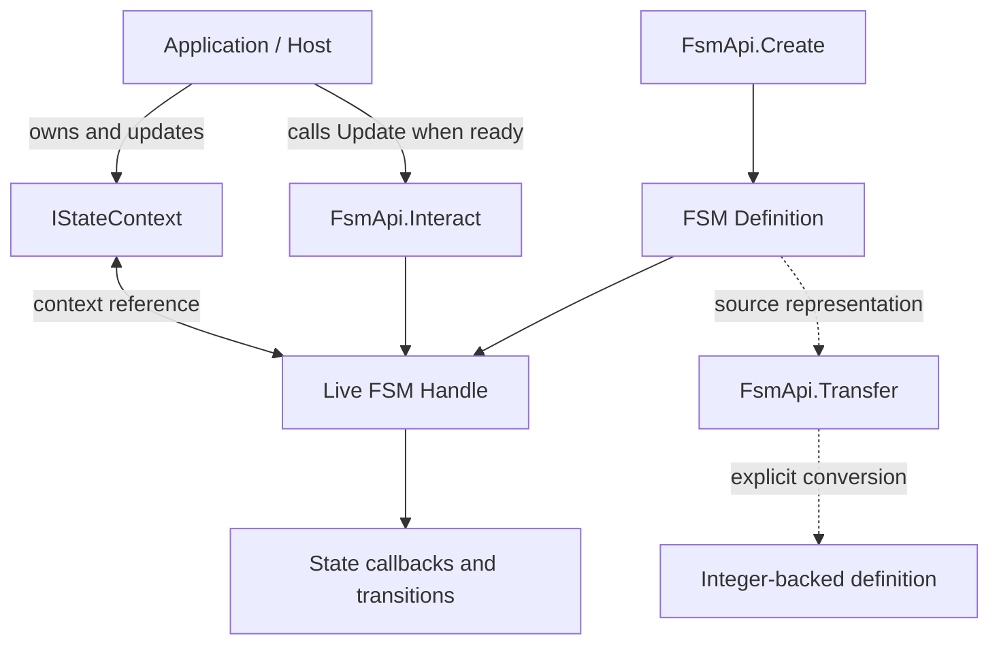
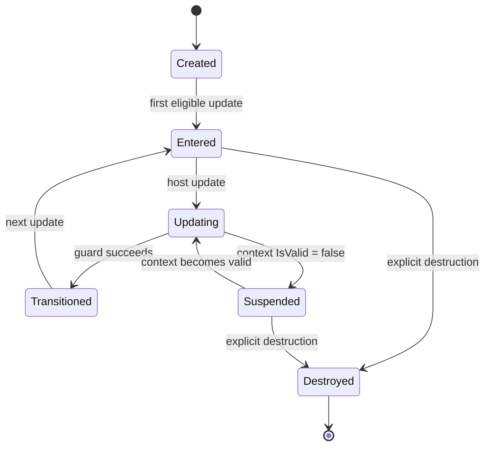

# FSM_API 2.0 — Behavior, made explicit

**A framework-independent finite-state-machine runtime for .NET.** Define behavior once, bind it to application-owned objects, and let your host decide when the machine advances.

<badge>2.0 development preview</badge>

This site is built from the active 2.0 integration candidate. It demonstrates the intended public API and documents the implementation under review. It is **not** a released package: NuGet remains on 1.x until the 2.0 verification and release gates are complete.

[Read the public API contract](Documentation/FSM_API_2.0.0_PUBLIC_API_CONTRACT.md) · [Review release readiness](Documentation/FSM_API_2.0.0_READINESS.md) · [Browse source](https://github.com/TrentBest/FSM_API/tree/fix/integer-definition-reregistration)

## The central idea

Your application owns its data and its update loop. FSM_API owns the reusable behavior definition and the live state-machine handles bound to your contexts.



The context is not copied into an FSM-owned model. The handle keeps the caller's context reference; callbacks operate on that object. Setting `IsValid = false` suspends execution without implicitly destroying the instance.

## Try the 2.0 API shape

The concise consumer facade is `FSM_API.FsmApi`. Runtime data types, including `IStateContext`, remain in the established `TheSingularityWorkshop.FSM_API` namespace.

```csharp
using TheSingularityWorkshop.FSM_API;
using FsmApi = FSM_API.FsmApi;

var door = new DoorContext();

FsmApi.Create.CreateFiniteStateMachine(
        "Door",
        processRate: -1,
        processingGroup: "Update")
    .State("Closed",
        onEnter: context => ((DoorContext)context).IsOpen = false)
    .State("Open",
        onEnter: context => ((DoorContext)context).IsOpen = true)
    .WithInitialState("Closed")
    .Transition("Closed", "Open",
        context => ((DoorContext)context).RequestOpen)
    .Transition("Open", "Closed",
        context => !((DoorContext)context).RequestOpen)
    .BuildDefinition();

_ = FsmApi.Create.CreateInstance("Door", door, "Update");

// The host owns the clock. One call advances one update step.
door.RequestOpen = true;
FsmApi.Interact.Update("Update");

public sealed class DoorContext : IStateContext
{
    public string Name { get; set; } = "FrontDoor";
    public bool IsValid { get; set; } = true;
    public bool RequestOpen { get; set; }
    public bool IsOpen { get; set; }
}
```

**What to notice:** the definition describes behavior; the context carries application data; the host explicitly advances the processing group. With a process rate of `-1`, the definition is eligible on each host update call. FSM_API does not start a background loop or take ownership of the application.

## Two representations, one behavioral contract

2.0 retains both representations. They have separate runtime registries; the integer path is not a replacement for the string path.

| String-backed | Integer-backed |
| --- | --- |
| Readable definition and state names | Integer definition and state identities |
| Named processing groups | Integer processing-group identities |
| `FsmApi.Interact.Update("Update")` | `FsmApi.Interact.Update(7)` |
| `FSMHandle` | `FSMHandleInt` |

The facade exposes overloads for both creation paths:

```csharp
// String-backed definition
var named = FsmApi.Create.CreateFiniteStateMachine(
    "Worker", processRate: -1, processingGroup: "Update");

// Integer-backed definition
var indexed = FsmApi.Create.CreateFiniteStateMachine(
    42, processRate: -1, processingGroupID: 7);
```

Conversion is explicit at the boundary, through `FsmApi.Transfer`. The runtimes do not silently share registries or translate every integer lookup back into a string lookup.

**Parity is tested as behavior, not as matching method names.** The candidate includes trace comparisons for callback order, transition timing, invalid-context suspension/resumption, and tick-boundary definition replacement. Full parity—including diagnostic thresholds and exception paths—remains a release gate.

## A predictable lifecycle



The important distinction: invalidity suspends callback execution; it does not mean destruction. Definition changes requested during callbacks are committed at a defined tick boundary so handles in one tick observe a stable definition.

See the [runtime tick and mutation contract](Documentation/FSM_RUNTIME_TICK_AND_MUTATION_CONTRACT.md) for the exact rules.

## Explore the engineering evidence

- [Public API and namespace contract](Documentation/FSM_API_2.0.0_PUBLIC_API_CONTRACT.md)
- [2.0 readiness and remaining release gates](Documentation/FSM_API_2.0.0_READINESS.md)
- [Runtime tick and mutation contract](Documentation/FSM_RUNTIME_TICK_AND_MUTATION_CONTRACT.md)
- [Benchmarking contract](Documentation/Performance/BenchmarkingContract.md)
- [Generated API reference](api/index.html)
- [Source and tests for this candidate](https://github.com/TrentBest/FSM_API/tree/fix/integer-definition-reregistration)

The Pages build validates local documentation links and generates the DocFX API reference from the same candidate source. The site is a review surface, not a substitute for the test suite or a claim that every 2.0 release gate has passed.

## Release boundary

The current published package remains **TheSingularityWorkshop.FSM_API 1.0.13**. The 2.0 candidate is not published. Package metadata, complete cross-runtime parity, reproducible string-versus-integer performance evidence, compatibility validation, documentation review, and branch reconciliation remain part of release readiness.

No website content, successful build, or readiness percentage authorizes NuGet publication or merge to `master`.
